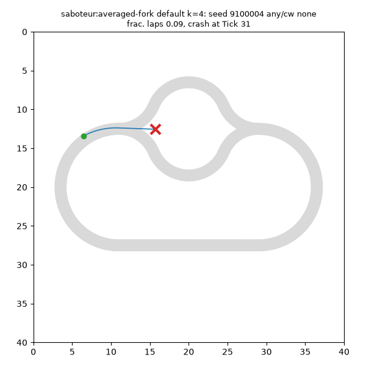
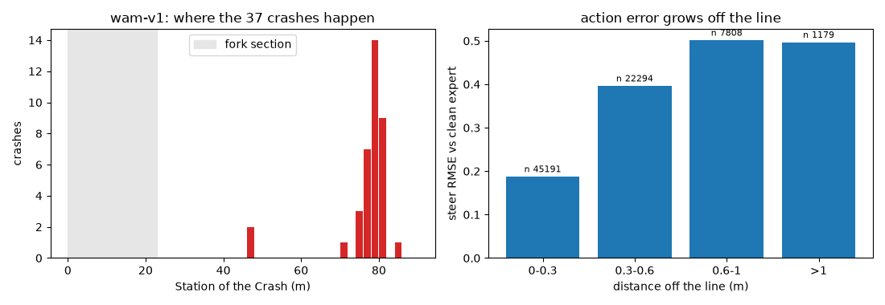
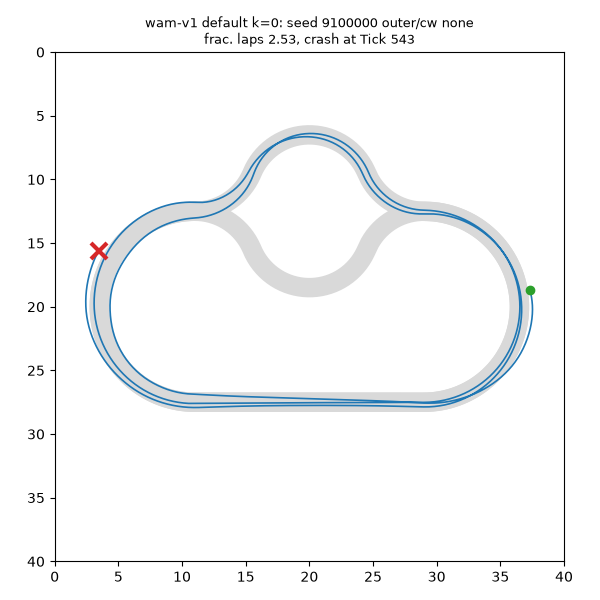

# Step 9: letting the model drive

2026-11-05 · plain-language explainer. The exact specification is `.scratch/step9-closed-loop/SPEC.md`. Words in *italics* on first use are explained in the [Glossary](#glossary) at the end.

## In one paragraph

Until now the model `wam-v1` was only graded on *recorded* driving: it saw a picture from an expert episode and its predicted actions were compared with what the expert did next. Step 9 hands it the wheel. In a *closed loop* the model's own actions move the car, the simulator draws the new picture, and the model has to deal with wherever it ended up, including places the expert never went. A *Driver* is anything the loop can run: the model (wrapped in a replanning *Scheme*), the scripted expert, or a *Saboteur*. Every Driver plays the same fixed list of 120 episodes. Four *gates* then say whether it drives well enough: it must not crash, it must keep up, it must take the branch it is told to, and with Instruction `any` it must use both branches.

## Why a closed loop is a different test

In the recorded data the car is always where the expert put it: near the middle of the road, at the expert's speed. A model can score well on that and still fail when driving itself. Every small error moves the car a little off the expert's line. The next picture is then slightly unfamiliar, the next error is a bit bigger, and so on. This *compounding error* is the classic weakness of learning by imitation. Only a closed loop shows it.

The model has no memory and no other feedback. Each time it is asked, it sees one picture, the State and the Instruction, and nothing else. *Replanning* (asking it again) is therefore its only way to notice that things are drifting and to correct.

```
          ┌──────────────────────────────────────────────┐
          ▼                                              │
  Frame + State + Instruction ──► model ──► Chunk of 16 actions
                                              │
                                 execute the first k actions
                                              │
                                     simulator steps ─────┘
```

## The Scheme: how the model drives

The model produces a *Chunk*, a plan of 16 actions. The Scheme decides how such plans become steering:

| Setting | Default | Why |
| --- | --- | --- |
| execute per replan | 1 action | replan every Tick: the fastest reaction to drift |
| samples per replan | 4 | draw four candidate Chunks from different noise |
| selection | coherence | keep the candidate that best continues the previous plan |
| Euler steps | 4 | measured as good as 10 here, and 2.5 × cheaper |
| guidance (CFG) | off | measured: no gain in the loop |
| noise | fresh per replan | a fixed seed per episode was no better |

**Coherence selection.** With four candidates per Tick, picking one at random would let the car switch its mind at the Fork from one Tick to the next: one Tick the plan says outer, the next inner. That's a *Fork flip*. Instead the loop keeps the candidate whose first actions are closest to what the previously chosen plan still had queued (later steps count a bit less, ρ = 0.9). The plans stay consistent and the car commits.

**Chunks are never averaged.** Averaging two plans is exactly the failure flow matching is meant to avoid: at the Fork, the average of "go left" and "go right" is "go straight into the island". The loop always executes one real sample.

**Same noise, whatever the batch.** For speed, all running episodes are sampled together in one batch. Each episode still draws its own noise from its own seed, so the result doesn't depend on which other episodes are running.

## Episodes

- **Evaluation sets** are fixed seed lists that were never recorded or trained on: `dev` (for tuning and sweeps), `gate` (120 episodes, the only one that gives a verdict, never tuned on) and `robustness` (60 episodes).
- Episode k plays Instruction × Direction combination k mod 6, so every 6 episodes cover outer/inner/any × clockwise/counter-clockwise once.
- An episode starts like the recorded data (same start rule, same colour jitter) and lasts 900 Ticks (60 s, about 4 expert laps). A Crash ends it.
- Every Driver plays the identical list, so rows can be compared episode by episode.

## The gates and the Saboteurs

| Gate | Passes if | Clean expert |
| --- | --- | --- |
| Crashes | crash rate ≤ 5 % | 0 % |
| Laps | mean *Fractional laps* ≥ 3.5 | 4.12 |
| Instruction followed | ≥ 95 % of episodes take only the instructed branch | 100 % |
| `any` balance | 0.30 ≤ fraction of `any` Passages on the outer branch ≤ 0.70 | 0.43 |

The thresholds come from what a good driver must achieve, not from the model's numbers. Fractional laps (distance / lap length) is used instead of whole laps because the whole-lap count can't tell a careful driver at 97 % of expert pace from a slow one.

**Do the gates catch what they should?** Each *Saboteur* is the clean expert with one defect. Each must fail exactly the gate it breaks, on the 120 gate episodes:

| Saboteur | Defect | Crash | Frac. laps | Followed | Outer | Fails |
| --- | --- | --- | --- | --- | --- | --- |
| expert | none | 0 % | 4.12 | 100 % | 0.43 | nothing |
| `zero-steer` | never steers | 100 % | 0.05 | 100 % | n/a | crashes, laps, balance |
| `averaged-fork` | averages "outer" and "inner" steering with `any` | 33 % | 2.89 | 100 % | n/a | crashes, laps, balance |
| `slow` | top speed 5 m/s | 0 % | 3.39 | 100 % | 0.43 | laps |
| `wrong-branch` | takes the other branch under outer/inner | 0 % | 4.12 | 33 % | 0.43 | followed |
| `always-outer` | always outer under `any` | 0 % | 4.12 | 100 % | 1.00 | balance |

`averaged-fork` is the regression failure in miniature: all 40 `any` episodes crash into the Island on their first Fork.



## What `wam-v1` does: FAIL

The full gate run (`runs/drive/20261105-1324-wam-v1`, 120 episodes, default Scheme, 46 min on an M1 Pro):

| Gate | `wam-v1` | 95 % interval | Expert | Result |
| --- | --- | --- | --- | --- |
| Crashes | 30.8 % (37 of 120) | 23.3–39.6 % | 0 % | FAIL |
| Laps | 3.36 | | 4.12 | FAIL |
| Instruction followed | 99.2 % | 95.4–99.9 % | 100 % | PASS |
| `any` balance | 0.50 | 0.42–0.59 | 0.43 | PASS |

**The Fork works. The corner doesn't.** Everything the model was built for passes. It takes the instructed branch (2 wrong Passages out of 380), it splits `any` evenly between the branches, and it never crashes into the Island (0 Island crashes, unlike `averaged-fork`). Its plans are committed: only 0.5 % of the Chunks classified near the Fork sit between the two branches. Episodes that don't crash run at full expert pace (4.13 Fractional laps).

The crashes have one cause. 35 of 37 happen when driving **clockwise**, and almost all at Station 75–82 m: the exit of the left end arc, just before the Fork. The car drifts toward the outside of that arc a little more on each lap, until one lap it leaves the road. Counter-clockwise it crashes in 2 of 60 episodes.





This is compounding error, measured. Near the line (< 0.3 m), the model's steer differs from what the clean expert would do in the same spot by 0.19 (RMSE, on a −1 … 1 scale). Between 0.6 and 1 m off the line the gap grows to 0.50. The expert's recordings rarely leave the line by that much, so the model has seen few examples of how to get back. The car is off the line by 0.29 m on average, against 0.01 m for the expert.

**Fork flips are still there.** In 72 of 141 `any` approaches, the plans chosen in the last 12 Ticks before the Fork disagree on the branch at least once. Coherence selection keeps the executed steering smooth, and none of these flips caused a crash. They are a report-only number, worth watching in Step 10.

**What the FAIL means.** It is the expected result of pure imitation, and an accepted finding (the dev estimate before the run was ≈ 25 % crashes, 3.1 laps). The fix is training data that shows the model how to recover from being off the line (DART-style noise, DAgger), for a `wam-v2`. That model is graded with this same loop, unchanged.

The replanning sweep (`--sweep replan`) and the robustness report (`--robustness`, ≈ 3.5 h) still need to be run and added here.

## How to run it

```sh
uv run python -m wam.closedloop eval expert                  # ≈ 15 s, all gates PASS
uv run python -m wam.closedloop eval saboteur:averaged-fork  # fails crashes, laps, balance
caffeinate -i uv run python -m wam.closedloop eval wam-v1    # ≈ 46 min, gate table + verdict; exit 1 on FAIL
caffeinate -i uv run python -m wam.closedloop eval wam-v1 --sweep replan
caffeinate -i uv run python -m wam.closedloop eval wam-v1 --robustness
uv run python -m wam.closedloop show wam-v1 --imagine        # watch live, with the imagined Frames
uv run --group viz python -m wam.closedloop video runs/drive/<run> --episode 3
```

Every run writes `runs/drive/<date-time>-<name>/` with the report (`report.md`), all numbers (`metrics.json`), one line per episode (`episodes.jsonl`) and every Tick (`ticks.npz`). The clean expert is always run on the same episodes as the reference row, so every table shows the gap to classical control.

## Glossary

**Chunk**: the 16 actions (steer, throttle) the model plans in one go.

**Closed loop**: the model's actions drive the simulator and the model sees the result, as opposed to grading it on recorded pictures.

**Compounding error**: small mistakes put the car in slightly unfamiliar places, where the next mistake is larger.

**Driver**: anything the loop can run: the model with a Scheme, the expert, or a Saboteur.

**Evaluation set**: a fixed list of episode seeds (`dev`, `gate`, `robustness`) that no Driver was trained or tuned on.

**Fork flip**: in the Ticks before the Fork, the chosen plans disagree on the branch.

**Fractional laps**: distance driven divided by the lap length (88 m), without rounding down.

**Gate**: a pass/fail threshold on one number.

**Push**: a few Ticks of extra steering added behind the Driver's back, to see whether it recovers.

**Replanning**: asking the model for a new Chunk before the old one is used up.

**Saboteur**: the clean expert with one deliberate defect, used to show a gate fails when it should.

**Scheme**: the settings that turn the model into a Driver (how many actions per plan, samples, selection, Euler steps, guidance, noise).

**Stress condition**: one change to the episodes for the robustness report: other colours, a wider fork, an off-line start, or Pushes.

**Tick**: one simulator step, 1/15 s.
